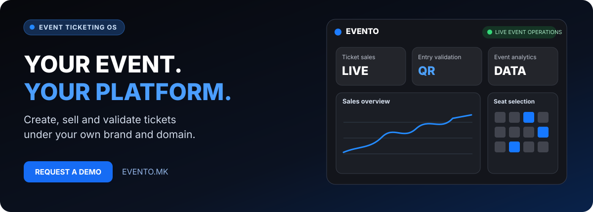

[Македонски](README.mk.md) · [English](README.md) · [Shqip](README.sq.md) · [Türkçe](README.tr.md)

  

 

[Македонски](README.mk.md) · [PROCESS IN Portfolio](https://github.com/stambolce/process-in)

### Nga publikimi i ngjarjes te hyrja e verifikuar.

**Nga publikimi i ngjarjes te hyrja e verifikuar.**

---

## Rrjedhë e plotë për organizatorin

**EVENTO**, nga **PROCESS IN**, lidh konfigurimin e ngjarjes, shitjen online me markën e organizatorit, kategoritë e biletave, verifikimin e hyrjes dhe raportimin. Është për organizatorë dhe ambiente që kërkojnë gjendje të qartë, gjurmueshmëri dhe më pak punë të shkëputur.

## Si funksionon

| Hapi | Rezultati |
|---|---|
| 01 | Konfiguroni identitetin, datën, hollësitë dhe cilësimet. |
| 02 | Përcaktoni kategoritë, kapacitetin dhe rregullat e shitjes. |
| 03 | Publikoni përmes përvojës online me markën e organizatorit. |
| 04 | Shisni bileta digjitale përmes pagesave të konfiguruara. |
| 05 | Verifikoni hyrjen me QR. |
| 06 | Shqyrtoni shitjet dhe pjesëmarrjen. |

## Mundësitë

| Fusha | Përdorimi |
|---|---|
| **Konfigurim dhe publikim** | Data, përshkrime dhe informacion për publikun. |
| **Domene të personalizuara** | Opsione domeni dhe marke sipas konfigurimit. |
| **Kategori dhe kapacitet** | Lloje, disponueshmëri dhe rregulla të mbështetura. |
| **Ulëse dhe ambient** | Harta dhe rrjedha ulësesh për konfigurimet e mbështetura. |
| **Raporte** | Bileta të lëshuara, shitje dhe hyrje të verifikuara. |
| **Përvoja me markën** | Identiteti dhe marrëdhënia e organizatorit me audiencën. |
| **Shitja digjitale** | Proces i strukturuar blerjeje online. |
| **Kontrolli QR** | Autenticiteti dhe pranimi në hyrje. |
| **Pagesat e organizatorit** | Pagesa dhe shlyerje sipas marrëveshjes kontraktuale. |
| **Operacionet dhe mbështetja** | Përgatitje, nevoja operative dhe ndihmë për organizatorin. |

## Për kë është

Organizatorë koncertesh e festivalesh, teatro dhe institucione kulturore, ekipe konferencash e ngjarjesh biznesi, ambiente me ulëse dhe promovues që kërkojnë shitje me markën e tyre.

## Çfarë ndryshon

Publikimi dhe shitjet bëhen një proces; marka mbetet e dukshme; hyrja kontrollohet me QR; raportimi lidhet me ngjarjen dhe konfigurimet përshtaten sipas biletave e eventit.

## Terminologjia

Bileta online, menaxhim ngjarjesh, skaner QR, validim biletash, white-label, shitje koncertesh, kontroll hyrjeje dhe raporte shitjesh janë fusha përkatëse. Nuk premtohen integrime të tjera ose rezultate tregtare.

## Informacion për produktin

| Hollësia | Vlera |
|---|---|
| Produkti | EVENTO |
| Faqja zyrtare | [evento.mk](https://evento.mk) |
| Kategoria | Platformë biletash dhe operacionesh ngjarjesh |
| Statusi | LIVE |
| Zhvilluesi | [PROCESS IN](https://processin.mk) |
| Portofoli | [PROCESS IN](https://github.com/stambolce/process-in) |

### [Vizitoni EVENTO](https://evento.mk)

Prezantim publik i produktit. Pa kod privat, të dhëna përdoruesish ose sekrete. Nuk jepet licencë me burim të hapur. Disponueshmëria dhe kushtet konfirmohen zyrtarisht.

---

This platform is a digital product of <a href="https://processin.mk" target="_blank" >PROCESS IN </a>· Your Enterprise Software & AI Partner ·  Hosted on Enterprise Infrastructure by <a href="https://inhost.mk" target="_blank">INHOST</a>·
